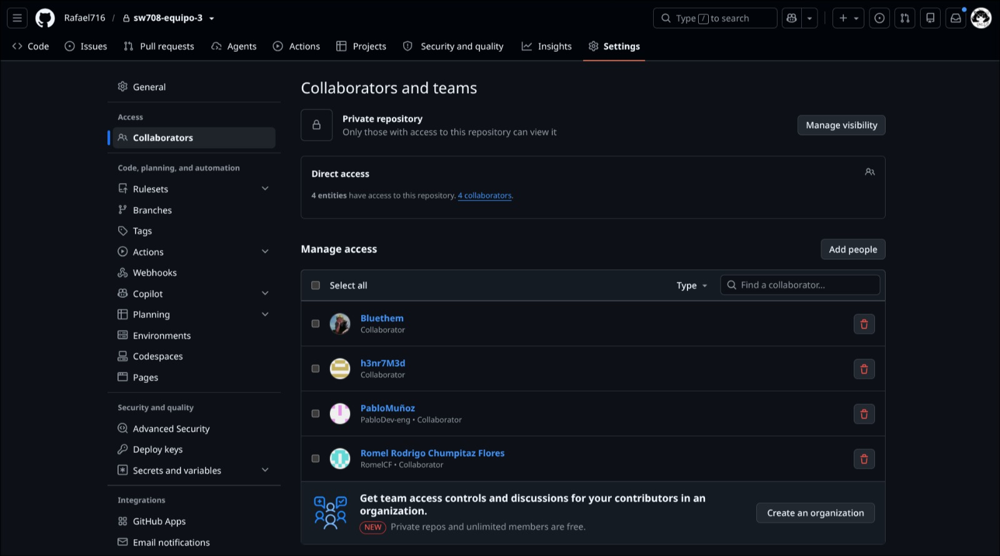

# SW708 · Equipo 3 — Arquitectura de Soluciones

Sistema de **Gestión de Operaciones Marítimas y Monitoreo en Tiempo Real** orientado a la logística de contenedores de Hapag-Lloyd. Integra reservas, operaciones marítimas/terrestres, personal de tripulación y monitoreo (incidencias, sensores, notificaciones y reportes) en un solo producto desplegable.

El código de aplicación vive en el submódulo [`src/repo`](./src/repo) (origen: curso de Diseño de Bases de Datos). Este repositorio documenta además el trabajo de arquitectura del curso **SW708** (escenarios de calidad, C4, ADRs, rodaja vertical).

---

## Qué hace el sistema

| Módulo | Responsabilidad | Tomados para el proyecto |
| --- | --- | --- |
| **Autenticación** | Login unificado y acceso por roles | [x] |
| **Gestión de reservas** | Alta y seguimiento de reservas de carga | [ ] |
| **Operaciones marítimas** | Buques, atraques, zarpes y estiba | [x] |
| **Operaciones terrestres** | Soporte portuario / terrestre | [ ] |
| **Personal / tripulación** | Datos de tripulación como soporte | [ ] |
| **Monitoreo** | Operaciones, contenedores, incidencias, notificaciones, reportes y mapa | [x] |

Arquitectura: **monolito modular** (ADR-0001) con backend NestJS, frontend Next.js y PostgreSQL con un esquema por dominio más `shared`. Stack unificado en TypeScript (ADR-0002).

---

## Estructura del repositorio

```
sw708-equipo-3/
├── docs/                 # Informes y entregas de arquitectura
├── semana-01 … semana-07 # Avances semanales, ADRs, bitácoras
└── src/repo/             # Submódulo con la aplicación
    └── app/
        ├── backend/      # NestJS (API, puerto 3001)
        ├── frontend/     # Next.js (UI, puerto 3000)
        └── docker-compose.yml
```

Documentación útil:

- [Documentación de la app](https://github.com/Bluethem/dbdgrupo5-25-2/blob/a4a342f463dd24ddbfb87f32dc50e2e34ce44f38/app/README.md)
- [Deploy](https://github.com/Bluethem/dbdgrupo5-25-2/blob/a4a342f463dd24ddbfb87f32dc50e2e34ce44f38/DEPLOY.md)

---

## Cómo ejecutarlo

Requisitos: **Node.js ≥ 20.9**, **pnpm ≥ 9**, y (recomendado) **Docker**.

### 1. Clonar e inicializar el submódulo

```bash
git clone https://github.com/Rafael716/sw708-equipo-3.git
cd sw708-equipo-3
git submodule update --init --recursive
cd src/repo/app
```

### 2. Opción A — Docker Compose (recomendada)

Levanta PostgreSQL + backend + frontend:

```bash
cp .env.example .env   # opcional: ajustar credenciales
docker compose up -d --build
```

| Servicio | URL |
| --- | --- |
| Frontend | http://localhost:3000 |
| Backend | http://localhost:3001 |
| PostgreSQL | red interna `db:5432` |

Datos de prueba (seed):

```bash
./scripts/poblamiento_datos/seed.sh
```

Credencial de demo: `admin@demo.com` / `Admin123!`

Comandos útiles:

```bash
docker compose logs -f backend
docker compose down          # detener
docker compose down -v       # detener y borrar volumen de BD
```

### 3. Opción B — Desarrollo local (pnpm)

Con PostgreSQL disponible (por ejemplo solo el servicio `db` de Docker):

```bash
pnpm install
pnpm dev:backend    # http://localhost:3001
pnpm dev:frontend   # http://localhost:3000
# o ambos:
pnpm dev
```

Build y tests:

```bash
pnpm build
pnpm test
```

---

## Colaboradores

| # | Integrante | Código | Usuarios de GitHub |
| --- | --- | --- | --- | 
| 1 | Rafael Adriano Olivos Gallardo | 20231296G | Rafael716 |
| 2 | Romel Rodrigo Chumpitaz Flores | 20231014A | RomelCF |
| 3 | David Luza Ccorimanya | 20232595H | Bluethem |
| 4 | Henry Javier Medina Malpartida | 20232571A | h3nr7M3d |
| 5 | Pablo Antonio Muñoz Bolaños | 20242090F | Pablo-Dev |


