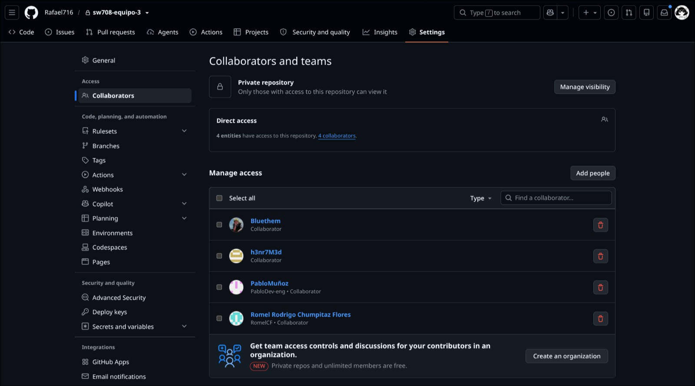

# SW708 · Equipo 3 — Arquitectura de Soluciones

Sistema de **Gestión de Operaciones Marítimas y Monitoreo en Tiempo Real** orientado a la logística de contenedores de Hapag-Lloyd. Integra reservas, operaciones marítimas/terrestres, personal de tripulación y monitoreo (incidencias, sensores, notificaciones y reportes) en un solo producto desplegable.

El código de aplicación vive en [`src/repo`](./src/repo) (antes submódulo del curso de Diseño de Bases de Datos; ahora código propio de este repositorio). La documentación de arquitectura del curso **SW708** está en [`docs/`](./docs/).

---

## Qué hace el sistema

| Módulo | Responsabilidad | Tomados para el proyecto |
| --- | --- | --- |
| **Autenticación** | Login unificado y acceso por roles | [x] |
| **Gestión de reservas** | Alta y seguimiento de reservas de carga | [ ] |
| **Operaciones marítimas** | Buques, atraques, zarpes y estiba | [x] |
| **Operaciones terrestres** | Soporte portuario / terrestre | [ ] |
| **Personal / tripulación** | Datos de tripulación como soporte | [ ] |
| **Monitoreo** | Operaciones, contenedores, incidencias, notificaciones, reportes y mapa | [x] |

Arquitectura: **monolito modular** ([ADR-0001](./docs/adr/0001-monolito-modular.md)) con backend NestJS, frontend Next.js y PostgreSQL con un esquema por dominio más `shared`. Stack unificado en TypeScript ([ADR-0002](./docs/adr/0002-stack-typescript-nestjs-nextjs.md)). Rodaja de Incidencias con puertos y adaptadores ([ADR-0003](./docs/adr/0003-puertos-y-adaptadores.md)).

---

## Estructura del repositorio

```
sw708-equipo-3/
├── .github/workflows/    # CI: tests + dependency-cruiser
├── docs/                 # Informe (arquitectura.md), ADR, reglas de negocio
│   ├── arquitectura.md
│   ├── reglas-de-negocio.md
│   ├── guia-git.md
│   └── adr/
├── semana-01 … semana-07 # Avances semanales, bitácoras, C4 fuente
└── src/repo/             # Aplicación (código propio, no submódulo)
    └── app/
        ├── backend/      # NestJS (API, puerto 3001)
        ├── frontend/     # Next.js (UI, puerto 3000)
        └── docker-compose.yml
```

Documentación útil:

- [Informe / arquitectura](./docs/arquitectura.md)
- [Reglas de negocio](./docs/reglas-de-negocio.md)
- [Guía Git (PRs y develop)](./docs/guia-git.md)
- [README de la app](./src/repo/app/README.md)
- [Deploy](./src/repo/DEPLOY.md)

---

## Cómo ejecutarlo

Requisitos: **Node.js ≥ 20.9**, **pnpm ≥ 9**, y (recomendado) **Docker**.

### 1. Clonar

```bash
git clone https://github.com/Rafael716/sw708-equipo-3.git
cd sw708-equipo-3
cd src/repo/app
```

### 2. Opción A — Docker Compose (recomendada)

```bash
cp .env.example .env   # opcional: ajustar credenciales
docker compose up -d --build
```

| Servicio | URL |
| --- | --- |
| Frontend | http://localhost:3000 |
| Backend | http://localhost:3001 |
| PostgreSQL | red interna `db:5432` |

Datos de prueba (seed), desde `src/repo`:

```bash
./scripts/poblamiento_datos/seed.sh
```

Credencial de demo: `admin@demo.com` / `Admin123!`

### 3. Opción B — Desarrollo local (pnpm)

Desde `src/repo/app`, con PostgreSQL disponible:

```bash
pnpm install
pnpm dev:backend    # http://localhost:3001
pnpm dev:frontend   # http://localhost:3000
pnpm dev            # ambos
pnpm build
pnpm test
```

### 4. CI local (misma regla que GitHub Actions)

```bash
cd src/repo/app
pnpm --filter backend test
pnpm --filter backend test:arch
```

---

## Colaboradores

| # | Integrante | Código | Usuarios de GitHub |
| --- | --- | --- | --- |
| 1 | Rafael Adriano Olivos Gallardo | 20231296G | Rafael716 |
| 2 | Romel Rodrigo Chumpitaz Flores | 20231014A | RomelCF |
| 3 | David Luza Ccorimanya | 20232595H | Bluethem |
| 4 | Henry Javier Medina Malpartida | 20232571A | h3nr7M3d |
| 5 | Pablo Antonio Muñoz Bolaños | 20242090F | PabloDev-eng |


