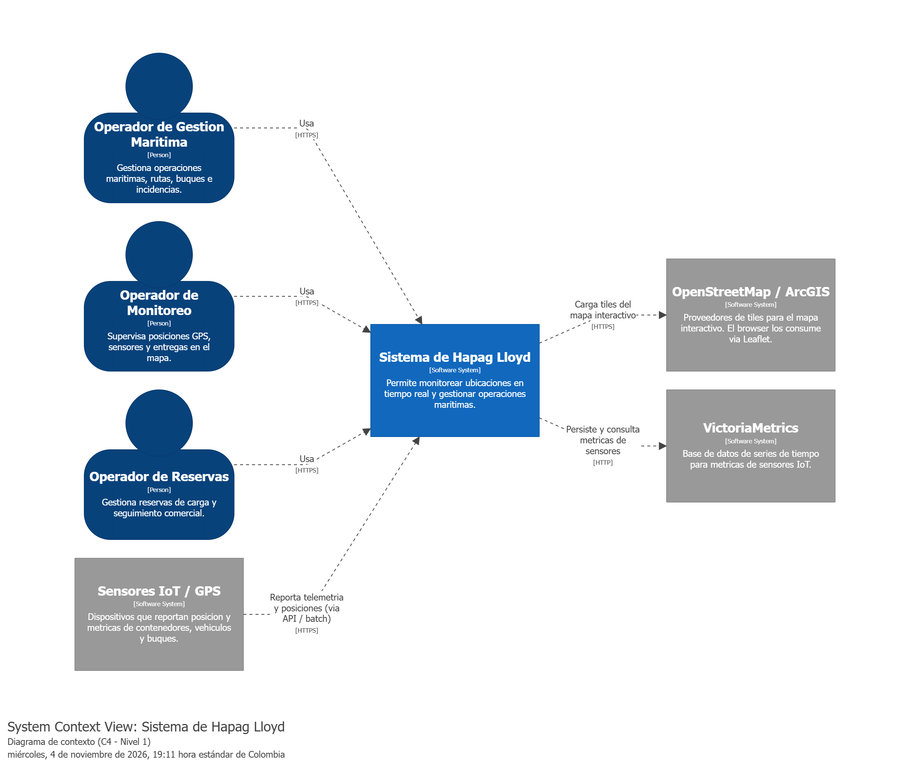
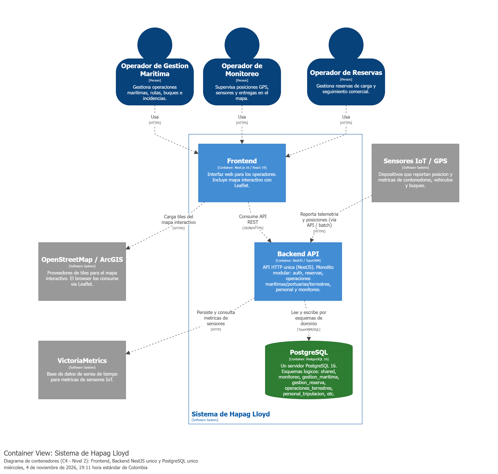
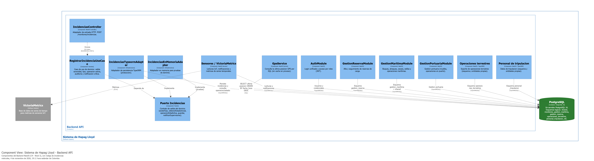

# Leyenda del modelo C4 — Sistema de Hapag Lloyd

## 1. Qué muestra cada figura

### Contexto (C4 - Nivel 1)

Muestra el sistema completo como una sola caja y su relación con el mundo exterior. Roles: **Operador de Gestión Marítima**, **Operador de Monitoreo** y **Operador de Reservas**. Externos: **OpenStreetMap / ArcGIS**, **VictoriaMetrics** y **Sensores IoT / GPS**.

---

### Contenedores (C4 - Nivel 2)

Tres contenedores reales de despliegue/almacenamiento:

| Contenedor | Tecnología | Nota |
|---|---|---|
| Frontend | Next.js 16 / React 19 | UI y mapa Leaflet |
| Backend API | NestJS / TypeORM | **Un solo proceso**: auth, reservas, marítima, portuaria, terrestres, tripulación y monitoreo |
| PostgreSQL | PostgreSQL 16 | **Un solo servidor** con varios esquemas lógicos (`shared`, `monitoreo`, `gestion_maritima`, `gestion_reserva`, `operaciones_terrestres`, `personal_tripulacion`, …) |

Los módulos Nest ya no se dibujan como contenedores distintos: son componentes del mismo Backend. Los esquemas no se dibujan como bases separadas.

---

### Componentes del Backend (C4 - Nivel 3)

Abre el **Backend API** y muestra:

- Módulos Nest registrados en `app.module.ts`: Auth, Gestión de Reservas, Gestión Marítima, Gestión Portuaria, más áreas de operaciones terrestres y personal de tripulación.
- **Rodaja vertical de Incidencias**: `IncidenciasController` → `RegistrarIncidenciaUseCase` → puerto `Incidencias` → adaptadores TypeORM y en memoria.
- `GpsService` (última posición por SQL) y sensores / VictoriaMetrics.

---

## 2. Fuente

El modelo versionado está en [`workspace.dsl`](./workspace.dsl). Las imágenes en `assets/` deben regenerarse desde Structurizr cuando cambie el DSL.

---

## 3. Observaciones del equipo revisor (histórico)

Se conserva el feedback del Equipo 1 de la semana 3 como referencia. Las acciones pendientes (unificar contenedores Nest, unificar PostgreSQL, mostrar la rodaja en componentes, reroute de sensores hacia el backend) quedaron aplicadas en el `workspace.dsl` actual.
