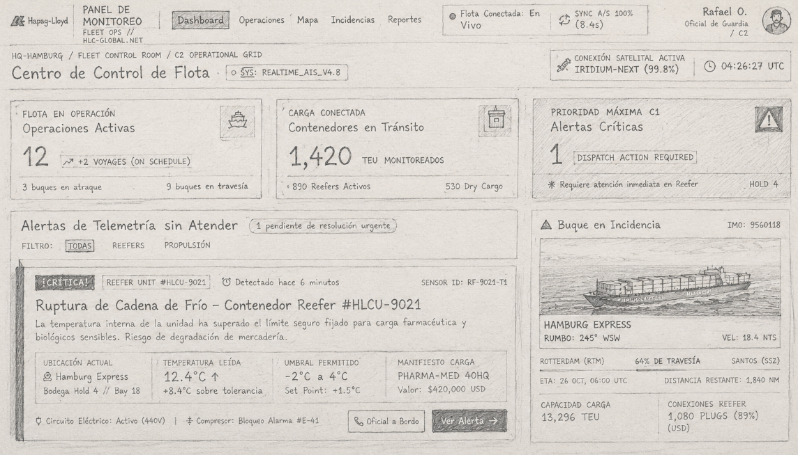
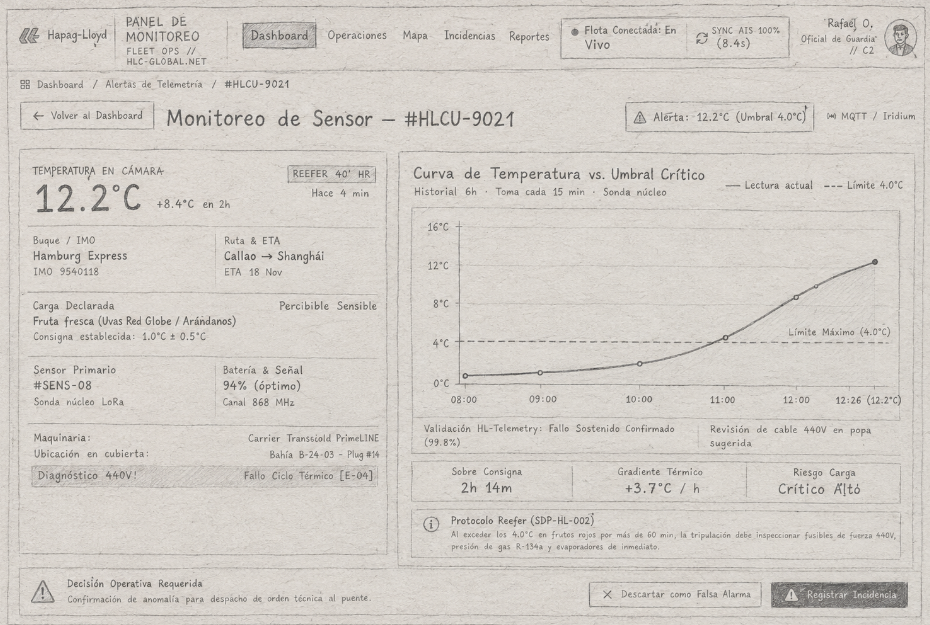
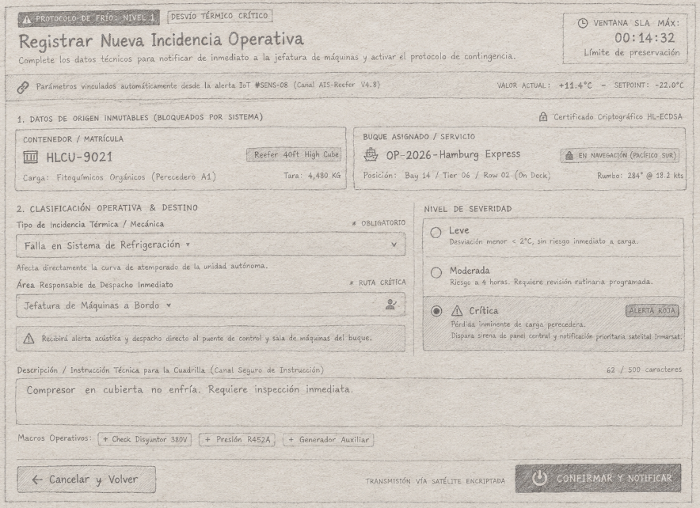
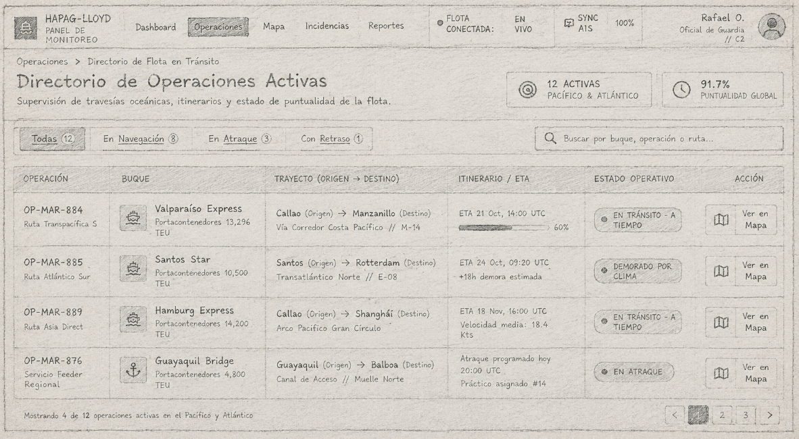
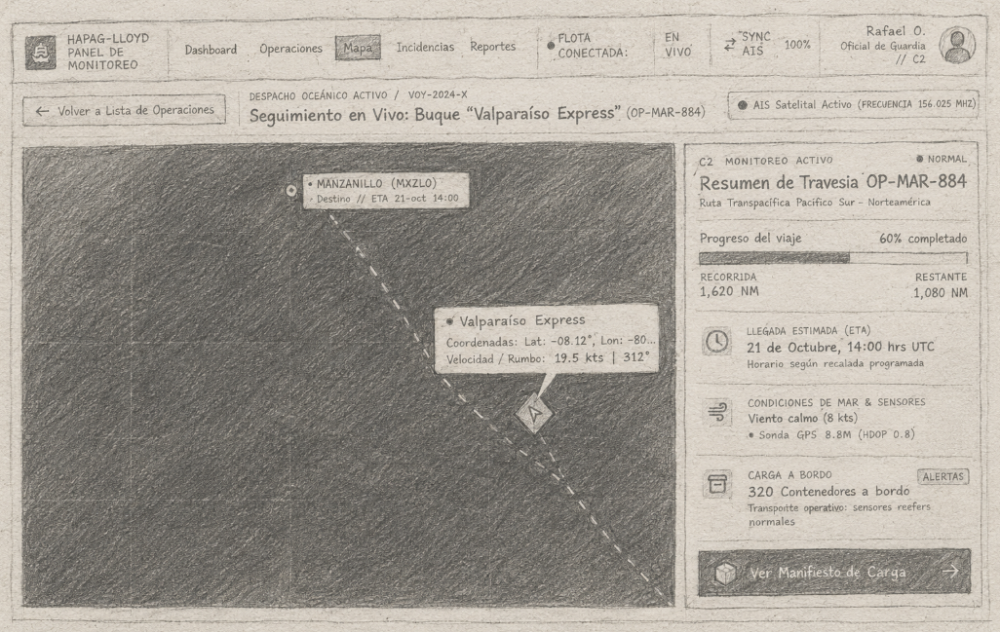
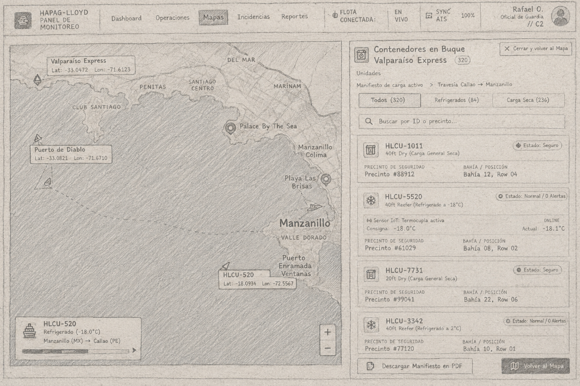

# Bocetos de Interfaz

## Flujo 1: Detección de Alerta IoT a Registro de Incidencia

* **Pantalla 1:**  
  

* **Pantalla 2:**  
  

* **Pantalla 3:**  
  

---

## Flujo 2: Seguimiento de Operación en Tránsito (Mapa y Carga)

* **Pantalla 1:**  
  

* **Pantalla 2:**  
  

* **Pantalla 3:**  
  
