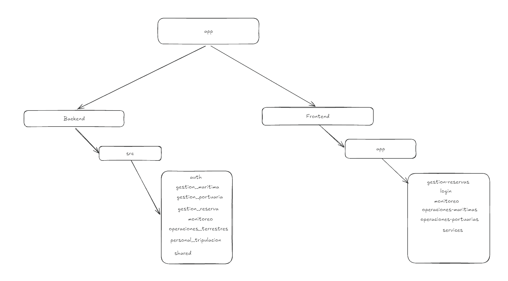

# Particiones

## Particion A

## Particion B

### Palabra: reserva

#### La palabra que cambia

- Para el módulo de gestion de reservas: Se necesita los datos del cliente, mercancia a transportar, fecha y hora en que desea la entrega.

- Para el módulo de gestión de operaciones marítimas: Se necesita la fecha en que partira la reserva, el buque donde sera transportado, el puerto de donde saldra, el puerto donde hay que llevarlo.

- Para el módulo de gestión de operaciones terrestres: Se necesita el camion donde se llevara la reserva, la estacion desde donde saldra, la estacion donde hay que llevarlo.

- Para el módulo de tripulacion: Se necesita saber que tripulacion que llevara la reserva.

- Para el módulo de monitoreo: Se necesita saber donde se encuentra exactamente la reserva y que incidentes tuvo junto con la fecha respectiva.

#### Cambian Juntas

Se evidencia que cuando el equipo hace un cambio, modifica al mismo tiempo el frontend y el backend de una sola área, sin tocar las demás:

- Para el módulo de monitoreo: En el commit 4494a9c ("Implementacion base de datos noSQL"), cambiaron juntos los servicios de sensores y base de datos con las pantallas del mapa en el frontend.

- Para el módulo de gestión de reservas: En los commits ea984eb y f772a44 ("update"), se modificaron juntos exclusivamente los controladores y servicios de reservas junto con sus paginas

- Para el módulo de gestión de operaciones portuarias / marítimas: En los commits 32205fc y 969faa1, cambiaron juntos los controladores portuarios con sus vistas de interfaz

#### Dueños distintos

- Para el módulo de gestion de reservas: personal de recepción de reservas.

- Para el módulo de gestion de operaciones marítimas: tripulantes, personal de logística.

- Para el módulo de gestión de operaciones terrestres: conductores, personal de logística 

- Para el módulo de tripulacion: capitan de la tripulación. 

- Para el módulo de monitoreo: personal de monitoreo, control y aseguramiento de calidad.

#### Ciclos distintos

- Para el módulo de gestión de reservas: Es la consulta que más se repite en el sistema, porque es el inicio de todo el flujo de la reserva.

- Para el módulo de gestión de operaciones marítimas: Se consulta con fecuencia media durante el traslado marítimo.

- Para el módulo de gestión de operaciones terrestres: Se consulta con frecuencia media durante el traslado terrestre.

- Para el módulo de tripulacion: Se consulta con poca frecuencia durante el traslado de la mercancia y para auditoria. 

- Para el módulo de monitoreo: El GPS se consulta constantemente y se maneja mediante la extension de TimeScale para PostgreSQL. 
 

## Confrontacion de escenarios