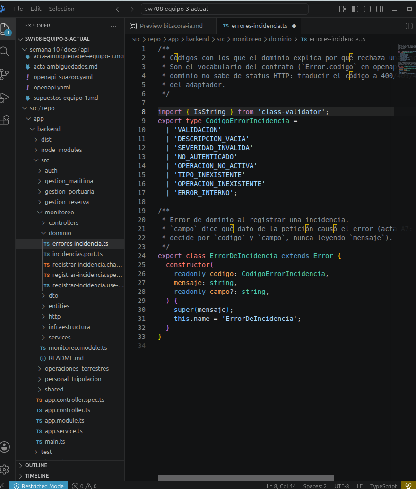
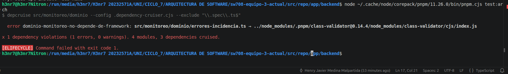
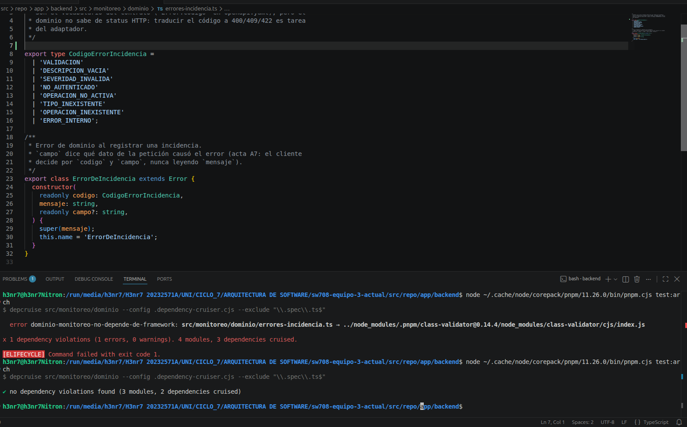

# Evidencia del paso 05 — regla de arquitectura ampliada

La regla activa sigue siendo **dependency-cruiser** (misma herramienta que la semana 6). En Lab 10 se amplió para que el dominio de monitoreo no importe el framework (Nest, TypeORM, Express, `class-validator`, etc.) ni el adaptador HTTP.

Configuración: `src/repo/app/backend/.dependency-cruiser.cjs`  
Comando: `pnpm --filter backend test:arch`  
CI: `.github/workflows/backend-arch.yml`

## Experimento: build en rojo → revertir → build en verde

1. Se importó a propósito `class-validator` en `monitoreo/dominio/errores-incidencia.ts`.
2. `pnpm test:arch` falló con `dominio-monitoreo-no-depende-de-framework`.
3. Se revirtió el import; la regla volvió a verde.

### Capturas

