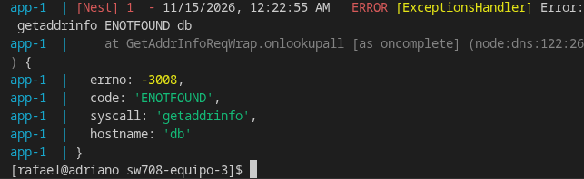
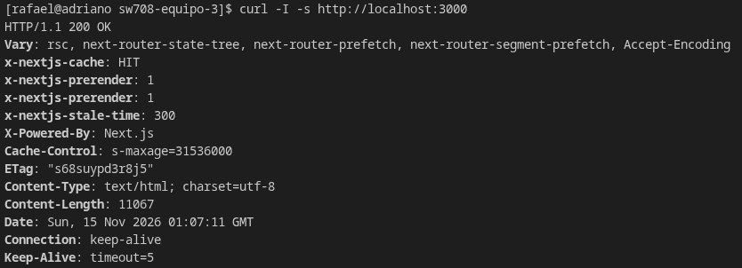

# Informe de Resiliencia

## Inyección de fallas 

### 1. Resumen de Experimentos

| Experimento | Componente apagado | Comando de inyección | Variable medida | Pregunta central |
| :--- | :--- | :--- | :--- | :--- |
| **Caso 1** | Base de datos (`db`) | `sudo docker compose stop db` | Tiempo de fallo de la petición (`time_total`) y status HTTP | ¿Hay un límite de espera o espera para siempre? |
| **Caso 2** | Backend / API (`app`) | `sudo docker compose stop app` | Comportamiento del Frontend (`http://localhost:3000`) y mensaje | ¿Se degrada el servicio o se cae entero? |

---

### 2. Caso 1: Detención de la Base de Datos (`db`)

#### 2.1. Hipótesis previa (escrita antes de apagar el servicio)
* **Comportamiento del proceso:** Al detener el contenedor de PostgreSQL (`db`), el backend (NestJS) no debería caerse; el proceso Node.js debe continuar en ejecución sirviendo peticiones.
* **Manejo de conexión y timeout:** El backend intentará conectarse a la base de datos al recibir una petición. Como el contenedor está detenido, esperamos que falle en un tiempo finito (límite de timeout de socket o DNS) y no se quede colgado para siempre.
* **Respuesta hacia el cliente:** La petición HTTP a un endpoint que consulte la base de datos (como `GET /auth/roles`) fallará con un código **`500 Internal Server Error`**.
* **Tiempo estimado:** Esperamos un tiempo medible de unos pocos segundos mientras el driver y el sistema de red resuelven el intento de conexión antes de abortar.

#### 2.2. Ejecución real de la prueba

1. **Detención de la base de datos:**
   ```bash
   sudo docker compose stop db
   ```

2. **Petición real con medición de tiempo:**
   Se consultó el endpoint público `GET /auth/roles` (el cual ejecuta `rolUsuarioRepository.find()` directamente contra PostgreSQL):
   ```bash
   curl -i -s -w "\nTiempo total: %{time_total}s\nCódigo HTTP: %{http_code}\n" \
     http://localhost:3001/auth/roles
   ```

3. **Salida real obtenida en la terminal:**
   
   

4. **Trazas reales en los logs del contenedor (`sudo docker compose logs --tail=20 app`):**
   
   

#### 2.3. Comparación: Hipótesis previa vs Resultado Real

| Aspecto | Hipótesis previa | Resultado real medido | Análisis |
| :--- | :--- | :--- | :--- |
| **Tiempo de respuesta** | Tiempo finito de pocos segundos | **3.678617 segundos** | El tiempo de ~3.68s corresponde a los reintentos de resolución de nombre en la red interna de Docker (`node:dns getaddrinfo`) antes de dar por fallida la búsqueda del host `db`. |
| **Código HTTP** | `500 Internal Server Error` | **500** (`{"statusCode":500,"message":"Internal server error"}`) | Se confirmó: NestJS atrapó la falla de base de datos en su `ExceptionsHandler` y devolvió un 500 estándar. |
| **¿Espera para siempre?** | No, debe haber un límite | **No espera para siempre**: falló tras 3.68s | Se comprobó empíricamente que existe un límite de espera determinado por la resolución DNS y el timeout del socket. |
| **Estado del proceso backend** | El contenedor debe seguir vivo | **Sigue vivo (`Up`)** | El proceso de Node.js no se cerró (no hizo crash), siguió atendiendo peticiones posteriores. |

---

### 3. Caso 2: Detención del Backend (`app`) desde la perspectiva del Frontend

#### 3.1. Hipótesis previa
* **Comportamiento esperado:** Al detener el contenedor `app` (`sudo docker compose stop app`), el servidor web de Next.js (`frontend`) continuará levantado en el puerto 3000 porque corre como un contenedor aislado.
* **Experiencia de usuario (UI):**
  * Las vistas estáticas y cascarones SSR cargan correctamente (HTTP 200).
  * Al intentar iniciar sesión o consultar información interactiva que dependa de la API (`http://localhost:3001`), la llamada fallará por rechazo de conexión (`Connection refused`).
* **Pregunta central:** ¿Se degrada el servicio o se cae entero?
  * **Hipótesis:** **Se degrada parcialmente**. La aplicación web sigue accesible sirviendo páginas pre-renderizadas, pero las operaciones dinámicas que dependen de la API quedan inoperativas.

#### 3.2. Ejecución real de la prueba

1. **Detención del backend:**
   ```bash
   sudo docker compose stop app
   ```
   *Salida de Docker:*
   ```text
   [+] stop 1/1
    ✔ Container sw708-app-1 Stopped  10.1s
   ```

2. **Acceso al Frontend (puerto 3000):**
   
   

3. **Llamada directa al puerto de la API detenida (`3001`):**
   ```bash
   curl -i http://localhost:3001/auth/roles
   ```
   *Salida:*
   
   

#### 3.3. Comparación: Hipótesis previa vs Resultado Real

| Aspecto | Hipótesis previa | Resultado real medido | Análisis |
| :--- | :--- | :--- | :--- |
| **Estado del Frontend** | Sigue respondiendo 200 | **HTTP 200 OK** (`Content-Length: 11067`, `x-nextjs-cache: HIT`) | Next.js sirvió con éxito el HTML pre-renderizado del cascarón web desde su caché interna en el puerto 3000. |
| **¿Se degrada o se cae entero?** | Se degrada parcialmente | **Se degrada parcialmente** | La aplicación web no se cayó por completo; el servidor Next.js sigue atendiendo a los usuarios, manteniendo visible la interfaz. |
| **Comportamiento de la API** | Rechazo de conexión | **Connection refused** (código 7 de curl) | El puerto 3001 quedó cerrado al detenerse el contenedor `app-1`. |
| **Experiencia del usuario** | El usuario puede ver la interfaz pero no enviar datos | **Degradación funcional graciosa** | El usuario puede interactuar con el diseño, pero cualquier acción que requiera autenticación o datos del backend informará error de conexión sin mostrar pantalla blanca de error de servidor. |

---

## Circuit breaker y timeout sobre VictoriaMetrics 

### 1. Qué dependencia se protegió y por qué

La única dependencia externa que el backend consume por HTTP es **VictoriaMetrics**, el almacén de series de tiempo que alimenta la demo de temperatura de contenedores y la sincronización de lecturas de sensores.

| Uso | Ruta | Tipo | Qué pasa si VictoriaMetrics no responde |
|---|---|---|---|
| Consulta de temperatura | `GET /monitoreo/vm/temperatura/:contenedorId` | lectura | El panel se queda esperando o falla la gráfica |
| Sincronización de lecturas | `POST /monitoreo/vm/sync-lecturas/sensor/:sensorId` | escritura | El operador cree que exportó lecturas que en realidad no llegaron |

No se escribió un circuit breaker a mano: se usa **opossum** (`opossum@^8.1.4`, ya declarado en `backend/package.json`), una librería mantenida con ventana deslizante de errores, estados cerrado/abierto/media apertura y fallback.

Código:

- `backend/src/shared/resiliencia/circuito-dependencia.ts` — envoltorio delgado sobre opossum y diagnóstico.
- `backend/src/shared/resiliencia/dependencia-no-disponible.error.ts` — error de dependencia caída, sin acoplar el servicio al contrato HTTP de Nest.
- `backend/src/monitoreo/services/victoriametrics.service.ts` — aplicación del patrón a VictoriaMetrics.
- `backend/src/monitoreo/controllers/vm-demo.controller.ts` — traducción a la respuesta HTTP definida.

El **timeout** está en dos capas a propósito:

1. `fetch(..., { signal: AbortSignal.timeout(2000) })` cancela la conexión HTTP y libera el socket.
2. El `timeout` de opossum actúa como respaldo lógico del breaker y contabiliza el fallo en la ventana.

Solo con el timeout de opossum, la promesa se rechaza pero la conexión HTTP puede seguir viva; por eso el `AbortSignal` es parte del cliente y no un adorno.

### 2. Valores elegidos y su motivo

Valores por defecto en `VALORES_RESILIENCIA_VM` (`victoriametrics.service.ts`). Todos se pueden ajustar por entorno sin recompilar.

| Parámetro | Valor | Variable de entorno | Por qué ese valor |
|---|---|---|---|
| Timeout de respuesta | **2000 ms** | `VICTORIA_METRICS_TIMEOUT_MS` | La consulta de la demo pide como máximo 8760 puntos (1 año a paso de 1 h, ~0.3 MB). En la red interna de Docker eso son decenas de ms; 2 s da ~10× de margen para un arranque en frío o un host cargado. El panel muestra un spinner y el usuario reintenta a los pocos segundos: esperar más de 2 s no mejora la decisión, solo alarga la degradación. |
| Porcentaje de errores | **50 %** | `VICTORIA_METRICS_CIRCUIT_ERROR_PERCENTAGE` | Es una dependencia de solo lectura para la demo. Abrir con la mitad de las llamadas fallando exige que el problema persista (no un pico aislado) y evita abrir por un único timeout de arranque. Con el mínimo de 5 llamadas, hacen falta al menos 3 fallos (60 %) para abrir. |
| Mínimo de llamadas en la ventana | **5** | `VICTORIA_METRICS_CIRCUIT_MIN_CALLS` | Evita el clásico "una llamada falló = 100 % de error". Cinco llamadas corresponden a varias pulsaciones del botón "Ver temperatura" y a un sync manual dentro de la ventana: si fallan, no fue casualidad. |
| Ventana de estadísticas | **10 s** | `VICTORIA_METRICS_CIRCUIT_WINDOW_MS` | Los fallos de hace un minuto no describen el estado actual de la dependencia. Con 10 s la decisión usa solo el presente inmediato y encaja con la espera de 15 s: al reabrir, la ventana ya está limpia. Los 10 buckets internos dan granularidad de 1 s. |
| Tiempo abierto antes de probar | **15 s** | `VICTORIA_METRICS_CIRCUIT_RESET_MS` | Un reinicio de VictoriaMetrics en `docker compose` tarda del orden de 5–10 s en volver a aceptar escrituras. 15 s cubre ese reinicio con margen y evita sondas mientras el servicio aún está levantando. Un valor de 5 s reabriría el circuito durante el arranque; 30 s o más dejaría el panel degradado demasiado tiempo por un hipo pasajero. Pasado ese tiempo el circuito pasa a **media apertura** y deja pasar una sola llamada de prueba. |
| Respuesta durante la espera | ver §3 | — | Se definió una respuesta distinta para lectura y escritura, porque no es lo mismo "no hay datos que mostrar" que "no se guardó lo que pediste". |
