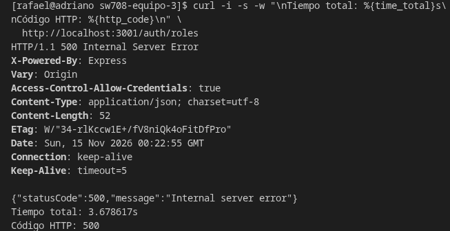
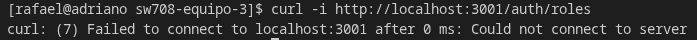
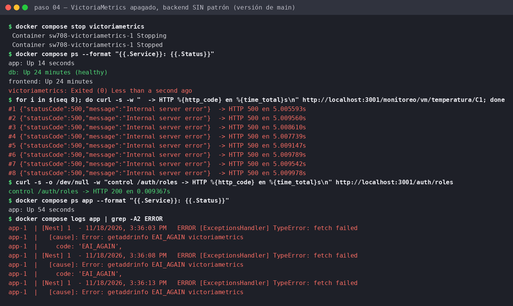
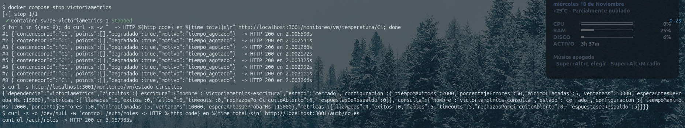
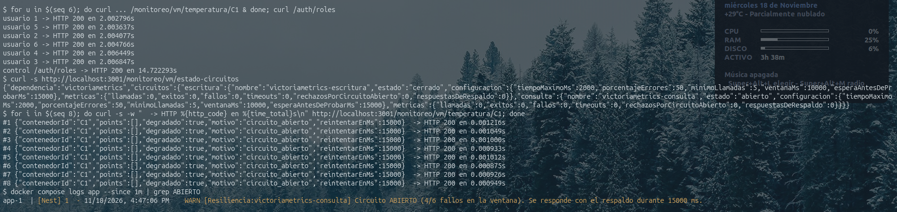
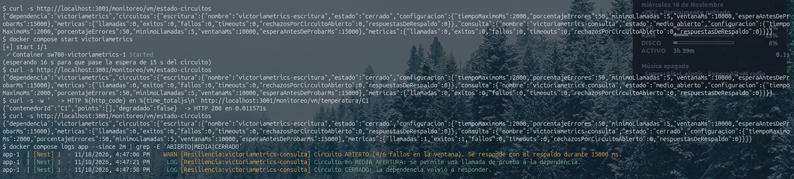

# Informe de Resiliencia

## Inyección de fallas 

### 1. Resumen de Experimentos

| Experimento | Componente apagado | Comando de inyección | Variable medida | Pregunta central |
| :--- | :--- | :--- | :--- | :--- |
| **Caso 1** | Base de datos (`db`) | `sudo docker compose stop db` | Tiempo de fallo de la petición (`time_total`) y status HTTP | ¿Hay un límite de espera o espera para siempre? |
| **Caso 2** | Backend / API (`app`) | `sudo docker compose stop app` | Comportamiento del Frontend (`http://localhost:3000`) y mensaje | ¿Se degrada el servicio o se cae entero? |

---

### 2. Caso 1: Detención de la Base de Datos (`db`)

#### 2.1. Hipótesis previa (escrita antes de apagar el servicio)
* **Comportamiento del proceso:** Al detener el contenedor de PostgreSQL (`db`), el backend (NestJS) no debería caerse; el proceso Node.js debe continuar en ejecución sirviendo peticiones.
* **Manejo de conexión y timeout:** El backend intentará conectarse a la base de datos al recibir una petición. Como el contenedor está detenido, esperamos que falle en un tiempo finito (límite de timeout de socket o DNS) y no se quede colgado para siempre.
* **Respuesta hacia el cliente:** La petición HTTP a un endpoint que consulte la base de datos (como `GET /auth/roles`) fallará con un código **`500 Internal Server Error`**.
* **Tiempo estimado:** Esperamos un tiempo medible de unos pocos segundos mientras el driver y el sistema de red resuelven el intento de conexión antes de abortar.

#### 2.2. Ejecución real de la prueba

1. **Detención de la base de datos:**
   ```bash
   sudo docker compose stop db
   ```

2. **Petición real con medición de tiempo:**
   Se consultó el endpoint público `GET /auth/roles` (el cual ejecuta `rolUsuarioRepository.find()` directamente contra PostgreSQL):
   ```bash
   curl -i -s -w "\nTiempo total: %{time_total}s\nCódigo HTTP: %{http_code}\n" \
     http://localhost:3001/auth/roles
   ```

3. **Salida real obtenida en la terminal:**
   
   

4. **Trazas reales en los logs del contenedor (`sudo docker compose logs --tail=20 app`):**
   
   

#### 2.3. Comparación: Hipótesis previa vs Resultado Real

| Aspecto | Hipótesis previa | Resultado real medido | Análisis |
| :--- | :--- | :--- | :--- |
| **Tiempo de respuesta** | Tiempo finito de pocos segundos | **3.678617 segundos** | El tiempo de ~3.68s corresponde a los reintentos de resolución de nombre en la red interna de Docker (`node:dns getaddrinfo`) antes de dar por fallida la búsqueda del host `db`. |
| **Código HTTP** | `500 Internal Server Error` | **500** (`{"statusCode":500,"message":"Internal server error"}`) | Se confirmó: NestJS atrapó la falla de base de datos en su `ExceptionsHandler` y devolvió un 500 estándar. |
| **¿Espera para siempre?** | No, debe haber un límite | **No espera para siempre**: falló tras 3.68s | Se comprobó empíricamente que existe un límite de espera determinado por la resolución DNS y el timeout del socket. |
| **Estado del proceso backend** | El contenedor debe seguir vivo | **Sigue vivo (`Up`)** | El proceso de Node.js no se cerró (no hizo crash), siguió atendiendo peticiones posteriores. |

---

### 3. Caso 2: Detención del Backend (`app`) desde la perspectiva del Frontend

#### 3.1. Hipótesis previa
* **Comportamiento esperado:** Al detener el contenedor `app` (`sudo docker compose stop app`), el servidor web de Next.js (`frontend`) continuará levantado en el puerto 3000 porque corre como un contenedor aislado.
* **Experiencia de usuario (UI):**
  * Las vistas estáticas y cascarones SSR cargan correctamente (HTTP 200).
  * Al intentar iniciar sesión o consultar información interactiva que dependa de la API (`http://localhost:3001`), la llamada fallará por rechazo de conexión (`Connection refused`).
* **Pregunta central:** ¿Se degrada el servicio o se cae entero?
  * **Hipótesis:** **Se degrada parcialmente**. La aplicación web sigue accesible sirviendo páginas pre-renderizadas, pero las operaciones dinámicas que dependen de la API quedan inoperativas.

#### 3.2. Ejecución real de la prueba

1. **Detención del backend:**
   ```bash
   sudo docker compose stop app
   ```
   *Salida de Docker:*
   ```text
   [+] stop 1/1
    ✔ Container sw708-app-1 Stopped  10.1s
   ```

2. **Acceso al Frontend (puerto 3000):**
   
   

3. **Llamada directa al puerto de la API detenida (`3001`):**
   ```bash
   curl -i http://localhost:3001/auth/roles
   ```
   *Salida:*
   
   

#### 3.3. Comparación: Hipótesis previa vs Resultado Real

| Aspecto | Hipótesis previa | Resultado real medido | Análisis |
| :--- | :--- | :--- | :--- |
| **Estado del Frontend** | Sigue respondiendo 200 | **HTTP 200 OK** (`Content-Length: 11067`, `x-nextjs-cache: HIT`) | Next.js sirvió con éxito el HTML pre-renderizado del cascarón web desde su caché interna en el puerto 3000. |
| **¿Se degrada o se cae entero?** | Se degrada parcialmente | **Se degrada parcialmente** | La aplicación web no se cayó por completo; el servidor Next.js sigue atendiendo a los usuarios, manteniendo visible la interfaz. |
| **Comportamiento de la API** | Rechazo de conexión | **Connection refused** (código 7 de curl) | El puerto 3001 quedó cerrado al detenerse el contenedor `app-1`. |
| **Experiencia del usuario** | El usuario puede ver la interfaz pero no enviar datos | **Degradación funcional graciosa** | El usuario puede interactuar con el diseño, pero cualquier acción que requiera autenticación o datos del backend informará error de conexión sin mostrar pantalla blanca de error de servidor. |

---

## Circuit breaker y timeout sobre VictoriaMetrics 

### 1. Qué dependencia se protegió y por qué

La única dependencia externa que el backend consume por HTTP es **VictoriaMetrics**, el almacén de series de tiempo que alimenta la demo de temperatura de contenedores y la sincronización de lecturas de sensores.

| Uso | Ruta | Tipo | Qué pasa si VictoriaMetrics no responde |
|---|---|---|---|
| Consulta de temperatura | `GET /monitoreo/vm/temperatura/:contenedorId` | lectura | El panel se queda esperando o falla la gráfica |
| Sincronización de lecturas | `POST /monitoreo/vm/sync-lecturas/sensor/:sensorId` | escritura | El operador cree que exportó lecturas que en realidad no llegaron |

No se escribió un circuit breaker a mano: se usa **opossum** (`opossum@^8.1.4`, ya declarado en `backend/package.json`), una librería mantenida con ventana deslizante de errores, estados cerrado/abierto/media apertura y fallback.

Código:

- `backend/src/shared/resiliencia/circuito-dependencia.ts` — envoltorio delgado sobre opossum y diagnóstico.
- `backend/src/shared/resiliencia/dependencia-no-disponible.error.ts` — error de dependencia caída, sin acoplar el servicio al contrato HTTP de Nest.
- `backend/src/monitoreo/services/victoriametrics.service.ts` — aplicación del patrón a VictoriaMetrics.
- `backend/src/monitoreo/controllers/vm-demo.controller.ts` — traducción a la respuesta HTTP definida.

El **timeout** está en dos capas a propósito:

1. `fetch(..., { signal: AbortSignal.timeout(2000) })` cancela la conexión HTTP y libera el socket.
2. El `timeout` de opossum actúa como respaldo lógico del breaker y contabiliza el fallo en la ventana.

Solo con el timeout de opossum, la promesa se rechaza pero la conexión HTTP puede seguir viva; por eso el `AbortSignal` es parte del cliente y no un adorno.

### 2. Valores elegidos y su motivo

Valores por defecto en `VALORES_RESILIENCIA_VM` (`victoriametrics.service.ts`). Todos se pueden ajustar por entorno sin recompilar.

| Parámetro | Valor | Variable de entorno | Por qué ese valor |
|---|---|---|---|
| Timeout de respuesta | **2000 ms** | `VICTORIA_METRICS_TIMEOUT_MS` | La consulta de la demo pide como máximo 8760 puntos (1 año a paso de 1 h, ~0.3 MB). En la red interna de Docker eso son decenas de ms; 2 s da ~10× de margen para un arranque en frío o un host cargado. El panel muestra un spinner y el usuario reintenta a los pocos segundos: esperar más de 2 s no mejora la decisión, solo alarga la degradación. |
| Porcentaje de errores | **50 %** | `VICTORIA_METRICS_CIRCUIT_ERROR_PERCENTAGE` | Es una dependencia de solo lectura para la demo. Abrir con la mitad de las llamadas fallando exige que el problema persista (no un pico aislado) y evita abrir por un único timeout de arranque. Con el mínimo de 5 llamadas, hacen falta al menos 3 fallos (60 %) para abrir. |
| Mínimo de llamadas en la ventana | **5** | `VICTORIA_METRICS_CIRCUIT_MIN_CALLS` | Evita el clásico "una llamada falló = 100 % de error". Cinco llamadas corresponden a varias pulsaciones del botón "Ver temperatura" y a un sync manual dentro de la ventana: si fallan, no fue casualidad. |
| Ventana de estadísticas | **10 s** | `VICTORIA_METRICS_CIRCUIT_WINDOW_MS` | Los fallos de hace un minuto no describen el estado actual de la dependencia. Con 10 s la decisión usa solo el presente inmediato y encaja con la espera de 15 s: al reabrir, la ventana ya está limpia. Los 10 buckets internos dan granularidad de 1 s. |
| Tiempo abierto antes de probar | **15 s** | `VICTORIA_METRICS_CIRCUIT_RESET_MS` | Un reinicio de VictoriaMetrics en `docker compose` tarda del orden de 5–10 s en volver a aceptar escrituras. 15 s cubre ese reinicio con margen y evita sondas mientras el servicio aún está levantando. Un valor de 5 s reabriría el circuito durante el arranque; 30 s o más dejaría el panel degradado demasiado tiempo por un hipo pasajero. Pasado ese tiempo el circuito pasa a **media apertura** y deja pasar una sola llamada de prueba. |
| Respuesta durante la espera | ver §3 | — | Se definió una respuesta distinta para lectura y escritura, porque no es lo mismo "no hay datos que mostrar" que "no se guardó lo que pediste". |

### 3. Respuesta con el circuito abierto

Qué responde el sistema mientras VictoriaMetrics no está es una **decisión de arquitectura**, no un detalle del código. Había tres opciones: un error claro, un dato viejo de caché o la función sin esa parte. No se eligió la misma para todo, porque una lectura y una escritura no fallan igual:

| Operación | Opción elegida | Respuesta HTTP | Por qué |
|---|---|---|---|
| **Lectura**: `GET /monitoreo/vm/temperatura/:id` | **La función sin esa parte** | `200` con `points: []`, `degradado: true`, `motivo` y, si el circuito está abierto, `reintentarEnMs: 15000` | La gráfica de temperatura es accesoria: el resto del panel de monitoreo sigue siendo útil sin ella. Un 5xx haría que la página trate todo como error; `degradado: true` le permite mostrar "sin datos por ahora" y seguir. |
| **Escritura**: `POST /monitoreo/vm/sync-lecturas/sensor/:id` | **Un error claro** | `503` con `codigo: DEPENDENCIA_NO_DISPONIBLE`, `dependencia`, `motivo`, `mensaje` y `reintentarEnMs: 15000` | Una escritura no se puede fingir: si respondiera 200, el operador creería que exportó lecturas que nunca llegaron. El 503 dice qué falló y cuándo tiene sentido volver a intentar (cuando el circuito vuelve a probar). |

**Por qué no un dato viejo de caché.** Para mostrar la última serie conocida habría que guardarla en algún lado. En memoria del proceso, rompe la escalabilidad horizontal: cada copia del backend tendría un caché distinto (es el "estado escondido" de la teoría). Fuera del proceso, agrega otra dependencia que también puede caer. Para una gráfica de demo no vale ese costo, y una temperatura vieja mostrada como actual puede engañar más que un "sin datos".

**El `motivo` dice qué pasó.** El campo se llena en las dos respuestas:

| `motivo` | Cuándo |
|---|---|
| `tiempo_agotado` | VictoriaMetrics no respondió en 2 s (timeout de opossum o `AbortSignal`) |
| `error_dependencia` | Falló la conexión o VictoriaMetrics devolvió 5xx (por ejemplo, el nombre no resuelve porque el contenedor está apagado) |
| `circuito_abierto` | Ni se llamó a VictoriaMetrics: el circuito está abierto y responde al instante |

Esta respuesta se usa **desde el primer fallo**, no solo con el circuito abierto: opossum usa el respaldo ante cualquier error o timeout. Lo que cambia al abrirse el circuito es el **tiempo**: deja de esperar los 2 s y responde en milisegundos.

**Qué no abre el circuito.** Un `4xx` de VictoriaMetrics (por ejemplo, una consulta PromQL mal armada por nosotros) es un defecto de la petición, no una caída de la dependencia: se ignora en el conteo (`errorFilter`) para no cortar un servicio sano por un bug propio.

**Por qué no hay reintentos.** La teoría propone tres defensas: timeout, reintento y circuit breaker. Aquí solo se usan las dos que exige el laboratorio. Reintentar la **escritura** podría duplicar lecturas en VictoriaMetrics, porque la exportación no tiene clave de idempotencia. En la **lectura**, reintentar contra una dependencia caída solo multiplica la espera: el usuario ya puede volver a pedir la gráfica, y el campo `reintentarEnMs` le dice cuándo.

**Por qué VictoriaMetrics no está en `depends_on`.** En `compose.yaml`, `app` solo espera a `db`. Si VictoriaMetrics fuera requisito de arranque, una caída suya impediría levantar el backend entero, y es justo lo contrario de degradar. La app arranca sin ella y el circuito se encarga de la falla.

---

## Experimento con VictoriaMetrics: la misma falla, antes y después del patrón

Los casos 1 y 2 apagaron la base de datos y el backend, pero el patrón protege a **VictoriaMetrics**. Para comparar *la misma falla* antes y después, este experimento apaga VictoriaMetrics en los dos intentos. Es el único servicio externo que el backend consume por HTTP (el lab acepta "un servicio externo" como dependencia a hacer fallar).

- **Qué se apaga:** `docker compose stop victoriametrics` (el frontend, el backend y la BD siguen arriba).
- **Qué se pide:** `GET /monitoreo/vm/temperatura/C1`, la consulta que usa la página `/monitoreo/vm-demo` para dibujar la temperatura de un contenedor. Se lanza 8 veces seguidas y se anota código HTTP y tiempo de cada una.
- **Control:** `GET /auth/roles` (solo usa la BD) para ver si el resto del sistema sigue atendiendo.
- **Antes del patrón:** backend de `main` (`fetch` sin timeout ni circuit breaker).
- **Después del patrón:** backend de esta rama (timeout de 2 s + circuit breaker de opossum, valores de la §2).

### Hipótesis (escrita antes de apagar VictoriaMetrics)

**Intento 1, sin el patrón (paso 04):**

| Pregunta | Qué esperamos | Por qué |
|---|---|---|
| ¿Cuánto tarda? | Unos **3–4 s por petición**, no se cuelga para siempre | Al detener el contenedor, el nombre `victoriametrics` deja de existir en la red de Docker. El `fetch` falla al resolverlo, como pasó con `db` en el caso 1 (3.68 s). No hay timeout propio: el límite lo pone la resolución DNS. |
| ¿Qué recibe el usuario? | **`500 Internal Server Error`**, sin explicación | El error del `fetch` no se captura; Nest lo convierte en un 500 genérico. La gráfica no se dibuja. |
| ¿Aprende de los fallos? | **No**: la petición 8 tarda lo mismo que la 1 | Nada recuerda que la dependencia está caída, así que cada petición vuelve a esperar. Con muchos usuarios, esas esperas se acumulan. |
| ¿El resto sigue? | **Sí**: `/auth/roles` responde 200 al instante y el backend no se reinicia | VictoriaMetrics no es requisito de arranque (no está en `depends_on`) y la falla solo afecta a las rutas que la usan. |

**Intento 2, con el patrón (paso 06):**

| Pregunta | Qué esperamos | Por qué |
|---|---|---|
| ¿Cuánto tarda? | Las primeras peticiones, **≤ 2 s**; desde que se abre el circuito, **milisegundos** | El timeout corta a los 2 s (si el DNS falla antes, falla antes). Con mínimo 5 llamadas y 50 % de error dentro de 10 s, el circuito se abre hacia la **5.ª petición** y las siguientes ni siquiera llaman a VictoriaMetrics. |
| ¿Qué recibe el usuario? | **`200`** con `points: []` y `degradado: true` **desde la primera petición**; el `motivo` cambia de fallo de la dependencia a `circuito_abierto` cuando el circuito se abre | El respaldo de opossum se usa ante cualquier fallo o timeout, no solo con el circuito abierto. Es la respuesta definida para la lectura con la dependencia caída: la página muestra "sin datos" en vez de un error. |
| ¿Aprende de los fallos? | **Sí**: `estado-circuitos` muestra `consulta: abierto` | Esa es la diferencia que buscamos con el patrón. |
| ¿Se recupera? | Al encender VictoriaMetrics, tras **15 s** el circuito prueba una llamada (media apertura) y, si responde, se cierra | Es el tiempo de espera elegido en la §2. |

### Intento 1: resultado sin el patrón (paso 04)

Ejecución (18-nov-2026): el backend se reconstruyó temporalmente con el código de `main` (`git checkout origin/main -- src/repo/app/backend/src`), se comprobó que no tenía el patrón (`/monitoreo/vm/estado-circuitos` → `404`). Luego se apagó VictoriaMetrics y se lanzaron 8 consultas seguidas.

```bash
docker compose stop victoriametrics
for i in $(seq 8); do curl -s -w "  -> HTTP %{http_code} en %{time_total}s\n" http://localhost:3001/monitoreo/vm/temperatura/C1; done
```



| Pregunta | Qué esperábamos | Qué pasó de verdad | ¿Acertamos? |
|---|---|---|---|
| ¿Cuánto tarda? | 3–4 s por petición, sin colgarse | **5.0 s por petición** (5.008–5.019 s en las 8), sin colgarse | **En parte.** Hay límite, pero es más alto: el log muestra `TypeError: fetch failed`: el `fetch` no logra resolver el nombre `victoriametrics` y el límite lo pone la resolución DNS (en `docker compose logs app` la causa aparece como `getaddrinfo EAI_AGAIN victoriametrics`). Con `db` (caso 1) fueron 3.68 s porque el driver de Postgres falla por otro camino. Nadie en el código decidió esos 5 s. |
| ¿Qué recibe el usuario? | `500` sin explicación | **`500`** `{"statusCode":500,"message":"Internal server error"}` en las 8 | **Sí.** En el log: `TypeError: fetch failed` sin capturar. La gráfica no se dibuja y el usuario no sabe por qué. |
| ¿Aprende de los fallos? | No: la 8.ª tarda igual que la 1.ª | La 1.ª tardó 5.019 s y la 8.ª 5.009 s | **Sí.** 8 peticiones = 40 s de espera acumulada contra una dependencia que ya sabíamos caída. |
| ¿El resto sigue? | Sí, `/auth/roles` 200 al instante y sin reinicio | **`/auth/roles` → `200` en 0.0096 s**; `app` siguió `Up` | **Sí.** La falla queda en las rutas que usan VictoriaMetrics: el servicio **se degrada**, no se cae entero. |

**Conclusión del intento 1:** el sistema no se cae, pero cada petición que toca VictoriaMetrics pierde 5 s y termina en un 500 genérico, siempre igual, porque nada recuerda que la dependencia está caída. Con varios usuarios abriendo la página, esas esperas se acumulan.

Tras la prueba se restauró el backend de la rama (`git checkout HEAD -- src/repo/app/backend`).

### Intento 2: resultado con el patrón (paso 06)

Ejecución (18-nov-2026): backend de esta rama (timeout 2 s + circuit breaker, valores de la §2). Se esperaron 11 s para vaciar la ventana de estadísticas y se apagó VictoriaMetrics, **la misma falla del intento 1**.

#### a) Un usuario, 8 consultas seguidas (igual que en el intento 1)



- Las 8 respondieron **`200`** con `points: []`, `degradado: true`, `motivo: "tiempo_agotado"`, **en 2.00 s cada una** (2.001–2.006 s; antes: `500` en 5.0 s).
- **El circuito no se abrió**: `estado-circuitos` muestra la consulta `cerrado` con `"llamadas":4, "fallos":5, "timeouts":5`.
- Justo después, `/auth/roles` tardó **3.96 s** (antes: 0.0096 s). Ver hallazgo 2.

#### b) Seis usuarios a la vez



- Las 6 consultas simultáneas respondieron `200` degradado en 2.0 s (2.003–2.007 s), y el circuito **se abrió** (`Circuito ABIERTO (4/6 fallos en la ventana)`).
- Las 8 consultas siguientes respondieron `200` con `motivo: "circuito_abierto"` y `reintentarEnMs: 15000` **en ~0.001 s** (0.0009–0.0012 s): ya ni se llama a VictoriaMetrics.
- Mientras las 6 consultas estaban en curso, `/auth/roles` tardó **14.7 s**. Ver hallazgo 2.

#### c) Recuperación



Según el log (hora UTC), el circuito se abrió a las 16:47:06 y pasó a **media apertura** a las 16:47:21, exactamente 15 s después (`estado-circuitos` → `medio_abierto`). Luego se encendió VictoriaMetrics y, pasados 16 s, la primera consulta fue la llamada de prueba: respondió `200` con `degradado: false` en 0.012 s y el circuito **se cerró** (16:47:58; métricas `"llamadas":1, "exitos":1`).

#### Hipótesis vs. resultado del intento 2

| Pregunta | Qué esperábamos | Qué pasó de verdad | ¿Acertamos? |
|---|---|---|---|
| ¿Cuánto tarda? | ≤ 2 s al principio; milisegundos al abrirse el circuito hacia la 5.ª petición | **2.0 s** en las 8 peticiones de un usuario; **0.001 s** solo cuando el circuito se abrió con 6 usuarios a la vez | **En parte.** El timeout funciona; el circuito no se abre con un solo usuario (hallazgo 1). |
| ¿Qué recibe el usuario? | `200` con `degradado: true` desde la 1.ª petición | **`200` con `degradado: true`** en todas, con el `motivo` correcto (`tiempo_agotado` → `circuito_abierto`) | **Sí.** |
| ¿Aprende de los fallos? | Sí, el circuito se abre | Solo con varios usuarios a la vez | **En parte** (hallazgo 1). |
| ¿Se recupera? | Media apertura a los 15 s y cierre si responde | Media apertura a los 15 s exactos, cierre con la primera llamada | **Sí.** |

#### Hallazgo 1: con un solo usuario el circuito no llega al mínimo de llamadas

opossum solo evalúa el porcentaje de errores si en la ventana hay al menos `minimoLlamadas` (5). Pero cada llamada fallida tarda el timeout completo (2 s), así que un usuario que consulta seguido mete como máximo **5 llamadas en 10 s**, y cuando se evalúa el fallo, la más antigua ya salió de la ventana (que avanza en tramos de 1 s): quedan 4. **5 llamadas × 2 s = 10 s = la ventana entera.** La captura de la prueba a lo confirma: con 5 fallos registrados, la ventana solo cuenta `"llamadas":4`. Los tres números de la §2 tienen sentido uno por uno, pero juntos dejan al circuito sin abrir para el caso de un solo usuario. Con carga real (varios usuarios) sí se abre, como mostró la prueba b.

Si el equipo quiere que también se abra con un solo usuario, hay que cumplir `minimoLlamadas × timeout < ventana`, por ejemplo con una ventana de 30 s o un mínimo de 3 llamadas. Se puede ajustar sin recompilar con `VICTORIA_METRICS_CIRCUIT_WINDOW_MS` o `VICTORIA_METRICS_CIRCUIT_MIN_CALLS`. **Pendiente de decisión del equipo.**

#### Hallazgo 2: el timeout libera al usuario, pero no el recurso

Mientras las 6 consultas a VictoriaMetrics estaban en curso, una ruta **sin** base de datos (`/monitoreo/vm/estado-circuitos`) respondió en 0.001 s, pero `/auth/roles` (**con** base de datos) tardó 14.7 s (la captura de la prueba b muestra 14.72 s; la comparación con la ruta sin base de datos se midió aparte, en terminal, sin captura). El proceso no estaba bloqueado: lo que se agotó fueron los **hilos de libuv** (4 por defecto en Node). Así lo explicamos:

1. Con VictoriaMetrics apagado, resolver el nombre `victoriametrics` (`getaddrinfo`) tarda unos 5 s y ocupa uno de esos 4 hilos (es lo que vimos en el intento 1).
2. El `AbortSignal` de 2 s le responde al usuario a tiempo, pero **no puede cancelar** esa búsqueda de DNS: el hilo sigue ocupado hasta que termina.
3. Con 6 consultas, los 4 hilos quedan ocupados. Cuando `/auth/roles` necesita abrir una conexión nueva a Postgres (el pool cierra las conexiones inactivas tras unos segundos), también tiene que resolver `db`, y espera en la cola.

Es el caso que plantea el laboratorio: *"¿una dependencia lenta agota los hilos?"*. Sí, y el timeout por sí solo no lo evita. Lo que lo limita es el circuito: con el circuito abierto ya no se lanzan búsquedas nuevas, y por eso `/auth/roles` volvió a responder al instante una vez abierto el circuito. Sin patrón no pasaba porque cada petición esperaba sus 5 s completos: no había búsquedas abandonadas acumulándose.

Mitigaciones posibles, **no aplicadas** (pendientes de decisión del equipo): abrir el circuito antes (hallazgo 1), aumentar `UV_THREADPOOL_SIZE` o configurar el pool de Postgres para mantener conexiones abiertas.

---

## Bitácora del experimento: la misma falla, antes y después del patrón

| | Antes del patrón (paso 04) | Después del patrón (paso 06) |
|---|---|---|
| **Qué se apagó** | VictoriaMetrics (`docker compose stop victoriametrics`); frontend, backend y BD arriba | Lo mismo: VictoriaMetrics, con el mismo comando |
| **Qué esperábamos** | `500` en 3–4 s por petición, sin aprender de los fallos; el resto del sistema sigue | `200` degradado; ≤ 2 s al principio y milisegundos al abrirse el circuito hacia la 5.ª petición; recuperación a los 15 s |
| **Qué pasó de verdad** | `500` genérico en **5.0 s** en las 8 peticiones (timeout de DNS, no nuestro); `/auth/roles` en 0.009 s; el backend siguió arriba | `200` con `degradado: true` en **2.0 s**. Con 1 usuario el circuito no se abrió (hallazgo 1); con 6 a la vez se abrió y respondió en **0.001 s**. Se recuperó solo a los 15 s. `/auth/roles` llegó a tardar 14.7 s mientras había consultas en curso (hallazgo 2) |
| **Qué cambió con el patrón** | — | El usuario recibe una **respuesta definida** ("sin datos", con motivo y cuándo reintentar) en vez de un 500; la espera baja de 5 s (decidida por nadie) a 2 s (decidida por el equipo); con el circuito abierto, la respuesta es instantánea y deja de presionar a la dependencia caída. Lo que no resolvió: el circuito necesita carga para abrirse, y el timeout no libera los hilos de DNS |
